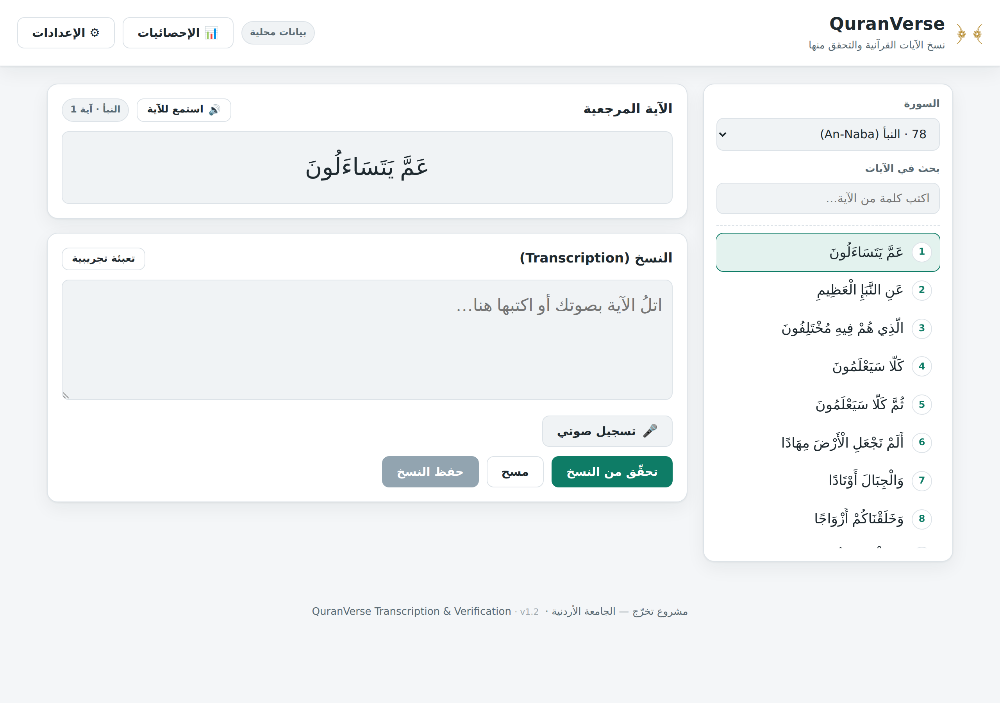
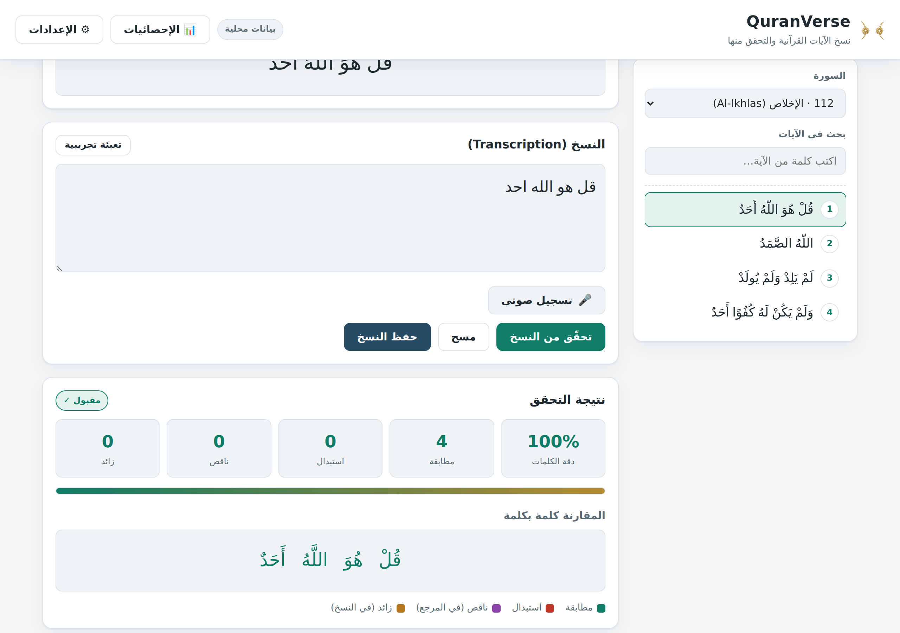
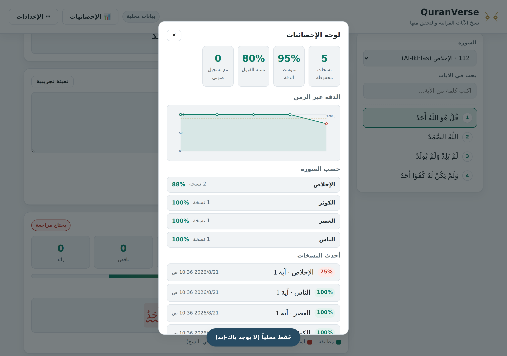

<h1 align="center">QuranVerse: Quran recitation checker</h1>

<p align="center">
  A web app that checks a recited or typed Quran verse word by word against the original text.<br/>
  <i>Graduation project, University of Jordan</i>
</p>

<p align="center">
  <a href="https://saeedramadancv-sys.github.io/quranverse/"></a>
</p>

<p align="center">
  
  
  
  
  
</p>

This was my graduation project at the University of Jordan. We were a team of two: my partner built the backend, and I led the front end and wrote the whole client app in plain JavaScript.

You pick a surah and an ayah from Juz' Amma, then type or dictate the verse. The app compares what you wrote with the Quran text word by word and shows which words were right, which were wrong, and which were missing or extra. The full text of Juz' Amma (all 37 surahs from An-Naba' to An-Nas, 564 ayahs) ships with the app, so browsing and checking typed text work offline.

---

## Screenshots

<p align="center">
  
  <br/><em>Browsing the 37 surahs of Juz' Amma and their ayahs</em>
</p>

<p align="center">
  
  <br/><em>A checked verse: accuracy score and colour-coded words (match, substitution, missing, extra)</em>
</p>

<p align="center">
  
  <br/><em>Statistics: accuracy over time, a breakdown per surah, and CSV/JSON export</em>
</p>

---

## Features

- The whole of Juz' Amma (37 surahs, 564 ayahs) from Tanzil.net's Quran-Simple text (Hafs), stored in the app so it works without a backend.
- Right-to-left Arabic shown in a Quran typeface (Amiri Quran).
- Dictation with the browser's speech recognition (Web Speech API, `ar-SA`). What you say is added to the text box. This part needs an internet connection in Chrome.
- A button to hear the reference recitation of the selected ayah (streamed from everyayah.com, so it also needs a connection).
- Audio recording during dictation, with playback and a downloadable 16-bit WAV file.
- Word-by-word checking that ignores diacritics, using a Levenshtein alignment (match, substitution, deletion, insertion).
- An accuracy score (word accuracy %) with a pass mark you can change.
- A statistics page built from your saved attempts: count, average accuracy, pass rate, recordings, a breakdown per surah, an accuracy-over-time chart (plain SVG, no chart library), and CSV or JSON export.
- Talks to the partner's REST API when it's available, and falls back to the built-in text and the local checker when it isn't.
- Installable as a PWA, with a service worker for offline use.
- Responsive layout with light and dark themes, live search within a surah, and a settings panel for the backend URL with a connection test.

---

## Project structure

```
quranverse/
├── www/                     # The web app (served in the browser and bundled into Android)
│   ├── index.html           # Markup and layout (dir="rtl", lang="ar")
│   ├── manifest.json        # PWA manifest
│   ├── sw.js                # Service worker for offline use
│   ├── icons/               # App icons
│   ├── css/styles.css       # RTL-first responsive styling, light/dark
│   └── js/
│       ├── config.js        # Backend URL and runtime settings (stored in localStorage)
│       ├── data.js          # The Juz' Amma text (37 surahs)
│       ├── verify.js        # The Arabic-aware checker (Levenshtein)
│       ├── api.js           # REST calls, with fallback to local data
│       ├── recite.js        # Plays the reference recitation for an ayah
│       ├── speech.js        # Speech-to-text (Web Speech API + native Android plugin)
│       ├── recorder.js      # Microphone capture and WAV export
│       ├── stats.js         # Local history and statistics (localStorage)
│       └── app.js           # UI controller
├── android/                 # Capacitor Android project (the APK is built here)
├── docs/screenshots/        # Images used in this README
├── .github/workflows/       # Publishes www/ to GitHub Pages
├── server.js                # Small static server for www/, no dependencies
├── start.bat                # Double-click to run the server and open the browser
├── sync-app.bat             # Double-click to run `npx cap sync android`
├── capacitor.config.json    # Capacitor config (appId, webDir=www)
├── package.json
└── BUILD_ANDROID.md         # How to build the APK
```

## Android app (Capacitor)

The web app is also wrapped as an Android app with Capacitor. The project is set up, but building the `.apk` needs Android Studio (the SDK and its bundled JDK). The steps are in [BUILD_ANDROID.md](BUILD_ANDROID.md). On a phone, speech-to-text uses the `@capacitor-community/speech-recognition` plugin, because the Android WebView doesn't have the Web Speech API. The backend URL should point at the partner server's LAN address, not `localhost`.

## Browser support for the voice features

Speech-to-text uses the Web Speech API, which works in Chrome, Edge and Safari but not Firefox, and it needs a secure page (`https://` or `localhost`). Recording uses `MediaRecorder` and the Web Audio API to make the WAV file. Both need microphone permission. If a voice feature isn't available, the app says so, and typing always works.

---

## Running locally

Serve the app over HTTP, because opening `index.html` straight from disk (`file://`) turns off some browser features. On Windows the easiest way is to double-click `start.bat`, which starts the bundled server and opens the browser. Or run it yourself:

```bash
node server.js       # serves www/ on http://localhost:8123/
```

Then open <http://localhost:8123/> in Chrome or Edge. The live version is on GitHub Pages at <https://saeedramadancv-sys.github.io/quranverse/>.

---

## Connecting the partner's backend

Open **⚙ الإعدادات** (Settings), set the API base URL, turn on "استخدام الباك-إند" and press **اختبار الاتصال** to test the connection. The settings are saved in `localStorage`.

The REST contract the app expects (change `js/api.js` if the backend differs):

| Method | Endpoint                     | Purpose                              |
|--------|------------------------------|--------------------------------------|
| GET    | `/surahs`                    | List surahs                          |
| GET    | `/surahs/{n}/ayahs`          | List ayahs of a surah                |
| POST   | `/verify`                    | Check a transcription on the server  |
| POST   | `/transcriptions`            | Save a checked transcription         |

`POST /verify` body:

```json
{ "surah": 112, "ayah": 1, "reference": "…", "transcription": "…" }
```

If the backend doesn't return `accuracy` or `ops`, the app works them out itself. That let us connect the two halves step by step while the backend was still being built.

---

## How the checking works

First the text is normalised: diacritics and tatweel are removed, and the different forms of alef, ya and ta marbuta are treated as the same letter. That way a transcription without diacritics can still match the fully marked reference. Then a word-level Levenshtein alignment labels every word and the app reports:

```
Word Accuracy = matches / referenceWords × 100
```

The default pass mark is 90%, and you can change it in `js/config.js`.

Everything is plain HTML, CSS and JavaScript, with no build step.

---

## License

MIT, see [LICENSE](LICENSE).

The Quran text comes from [Tanzil.net](https://tanzil.net) (Quran-Simple, Hafs) and is shared under Tanzil's terms. The license above only covers the app's code.

---

**Saeed Ramadan**, .NET backend developer, Amman, Jordan
[GitHub](https://github.com/saeedramadancv-sys) ·
[LinkedIn](https://www.linkedin.com/in/saeedramadan-dotnet) ·
saeed.ramadan.cv@gmail.com
